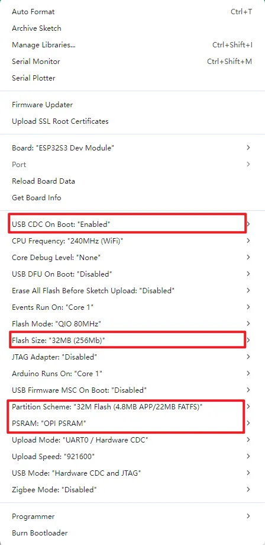
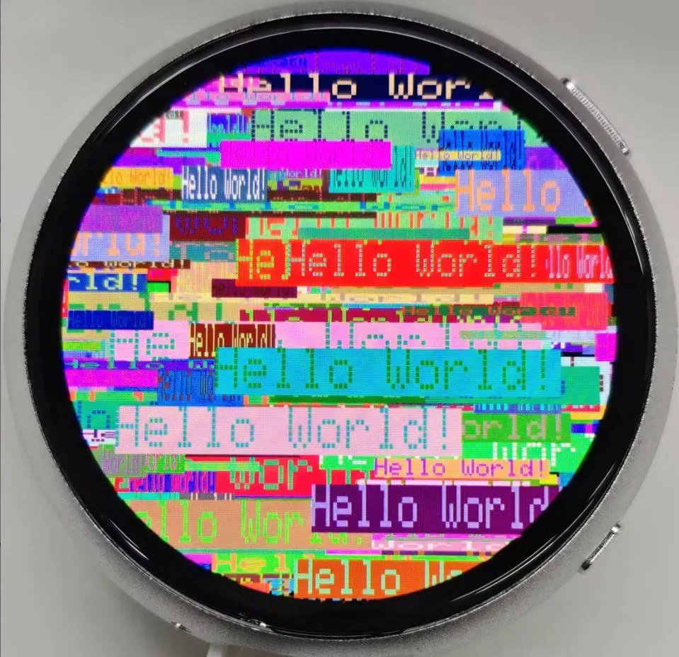
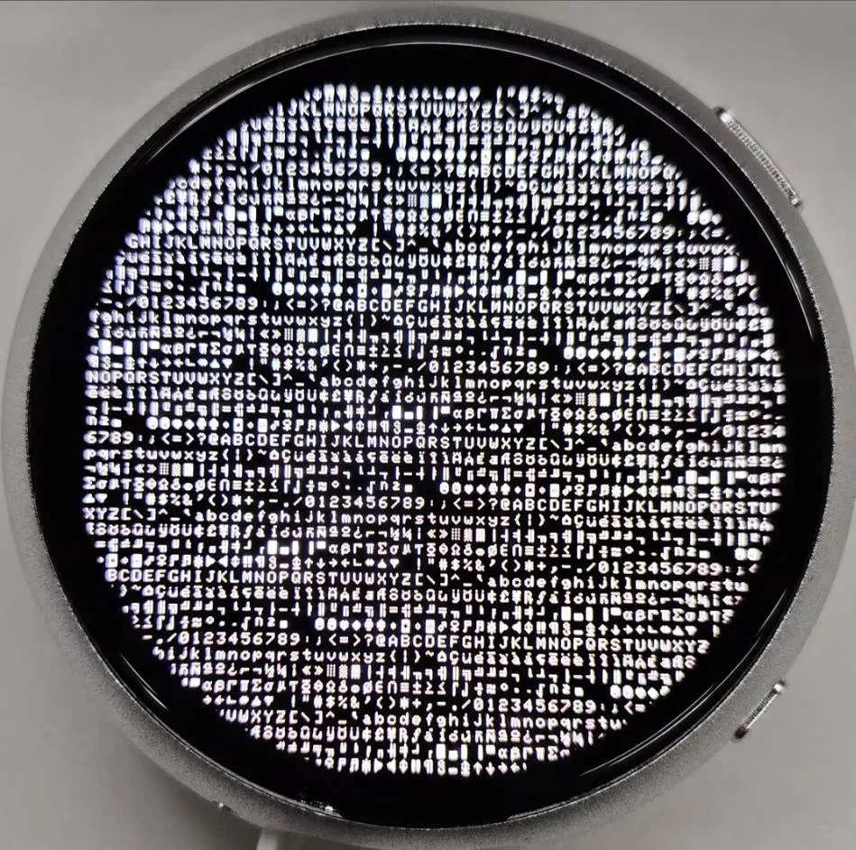
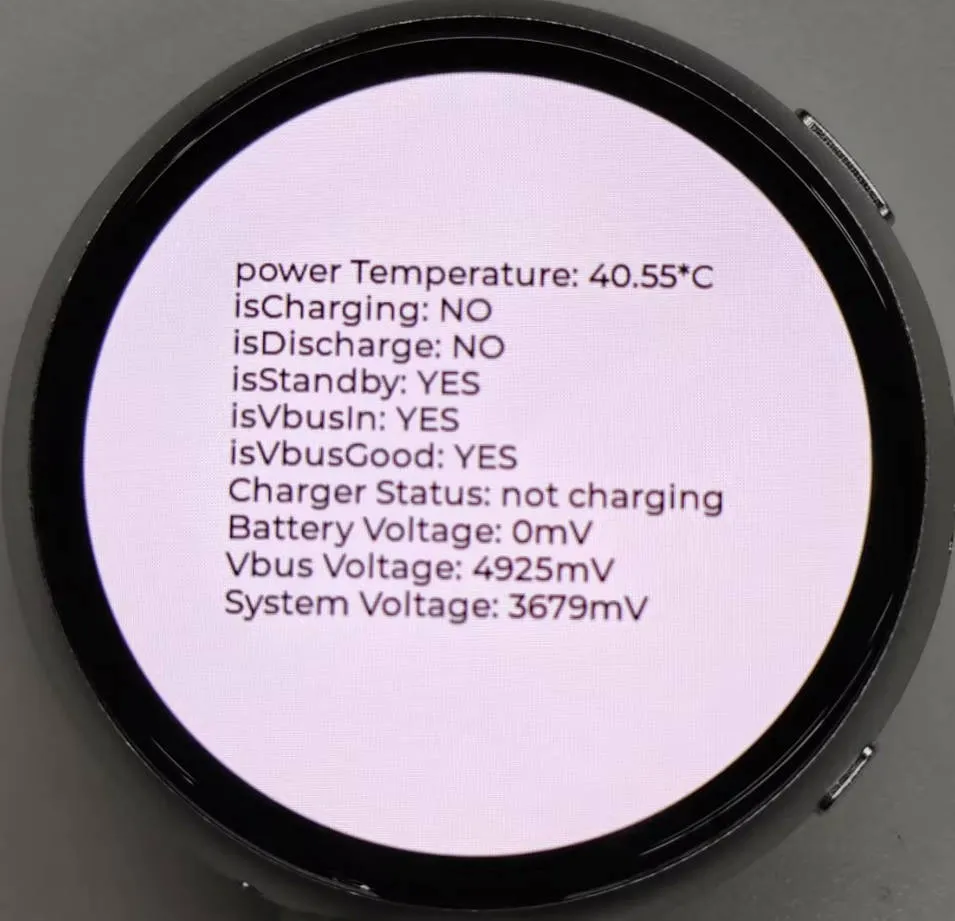
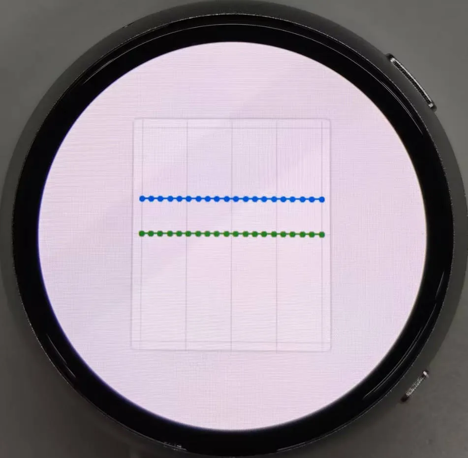
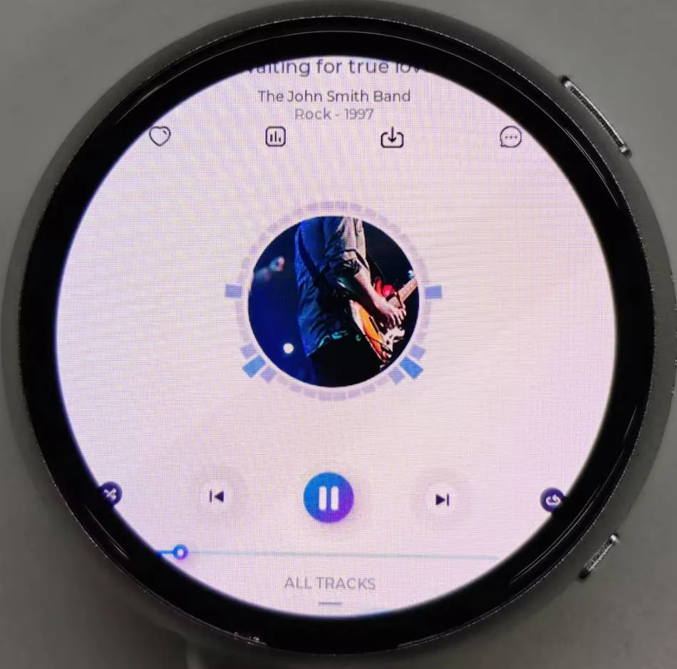

# Working with Arduino

This chapter includes the following sections, please read as needed:

- [Arduino Getting Started](#arduino-tutorial-for-beginners)
- [Setting Up Development Environment](#setting-up-development-environment)
- [Example](#example)

## Arduino Getting Started Tutorial

New to Arduino ESP32 development and looking for a quick start? We have prepared a comprehensive **[Getting Started Tutorial](https://docs.waveshare.com/ESP32-Arduino-Tutorials)** for you.

- [Section 0: Getting to Know ESP32](https://docs.waveshare.com/ESP32-Tutorials/Getting-To-Know-Esp32)
- [Section 1: Installing and Configuring Arduino IDE](https://docs.waveshare.com/ESP32-Arduino-Tutorials/Arduino-IDE-Setup)
- [Section 2: Arduino Basics](https://docs.waveshare.com/ESP32-Arduino-Tutorials/Arduino-Basics)
- [Section 3: Digital Output/Input](https://docs.waveshare.com/ESP32-Arduino-Tutorials/Digital-IO)
- [Section 4: Analog Input](https://docs.waveshare.com/ESP32-Arduino-Tutorials/Analog-Input)
- [Section 5: Pulse Width Modulation (PWM)](https://docs.waveshare.com/ESP32-Arduino-Tutorials/PWM)
- [Section 6: Serial Communication (UART)](https://docs.waveshare.com/ESP32-Arduino-Tutorials/UART-Communication)
- [Section 7: I2C Communication](https://docs.waveshare.com/ESP32-Arduino-Tutorials/I2C-Communication)
- [Section 8: SPI Communication](https://docs.waveshare.com/ESP32-Arduino-Tutorials/SPI-Communication)
- [Section 9: Wi-Fi Basics](https://docs.waveshare.com/ESP32-Arduino-Tutorials/WiFi-Networking-Basic)
- [Section 10: Web Server](https://docs.waveshare.com/ESP32-Arduino-Tutorials/Web-Server)
- [Section 11: Bluetooth](https://docs.waveshare.com/ESP32-Arduino-Tutorials/Bluetooth-Communication)
- [Section 12: LVGL GUI Development](https://docs.waveshare.com/ESP32-Arduino-Tutorials/LVGL)
- [Section 13: Comprehensive Project](https://docs.waveshare.com/ESP32-Arduino-Tutorials/Fun-Project)

**Note**: This tutorial uses the [ESP32-S3-Zero](https://www.waveshare.com/esp32-s3-zero.htm?sku=25517) as a reference example, and all hardware code is based on its pinout. Before you start, we recommend checking the pinout of your development board to ensure the pin configuration is correct.

## Setting Up Development Environment

### 1. Installing and Configuring Arduino IDE

Please refer to the tutorial **[Installing and Configuring Arduino IDE Tutorial](https://docs.waveshare.com/ESP32-Arduino-Tutorials/Arduino-IDE-Setup)** to download and install the Arduino IDE and add ESP32 support.

Install `esp32 by Espressif Systems` version **3.3.11** in Board Manager for the current examples.

### 2. Installing Libraries

- When installing Arduino libraries, there are typically two methods: **Online Installation** and **Offline Installation**. If the library installation requires offline installation, you must use the provided library file.
- For most libraries, users can easily search and install them through the online Library Manager in the Arduino software. However, some open-source libraries or custom libraries are not synchronized to the Arduino Library Manager, so they cannot be acquired through online searches. In this case, users can only manually install these libraries offline.

Download the [ESP32-S3-Touch-AMOLED-1.75C Source Archive](https://github.com/waveshareteam/ESP32-S3-Touch-AMOLED-1.75C/archive/refs/heads/main.zip). The `examples/arduino/libraries` directory within the package includes all the library files required for this tutorial.

| Library/File Name | Description | Version | Installation Method |
|----|----|----|----|
| GFX Library for Arduino | Graphics library with a CO5300 display driver | v1.6.4 | Install via library manager or manually |
| SensorLib | Drivers for the CST9217 touch controller and QMI8658 motion sensor | v0.3.3 | Install via library manager or manually |
| XPowersLib | AXP2101 driver library | v0.2.6 | Install via library manager or manually |
| lvgl | LVGL display framework | v8.4.0 | Install via library manager or manually |
| `board_config` | Board pin macro definitions | Provided in the example package | Install manually |
| lv_conf.h | LVGL configuration file | —— | Install manually |

Version Compatibility Description

There are strong dependencies between versions of LVGL and its driver libraries. For example, a driver written for LVGL v8 may not be compatible with LVGL v9. To ensure stable reproduction of the examples, it is recommended to use the specific versions listed in the table above. Mixing different library versions may cause compilation failures or runtime exceptions.

**Installation Steps**:

1.  Download the [ESP32-S3-Touch-AMOLED-1.75C Source Archive](https://github.com/waveshareteam/ESP32-S3-Touch-AMOLED-1.75C/archive/refs/heads/main.zip).

2.  Copy all folders (GFX_Library_for_Arduino, SensorLib, XPowersLib, lvgl, and board_config) from `examples/arduino/libraries` to the Arduino library folder. Copy the bundled `lv_conf.h` into the same folder, alongside `lvgl`.

    info

    The path to the Arduino libraries folder is typically: `c:\Users\<Username>\Documents\Arduino\libraries`.

    You can also locate it within the Arduino IDE via **File \> Preferences**, by checking the "**Sketchbook location**". **The library folder is the `libraries` folder under this path.**

3.  For other installation methods, please refer to: [Arduino Library Management Tutorial](https://docs.waveshare.com/ESP32-Arduino-Tutorials/Arduino-IDE-Setup#ArduinoIDE-Install-Libraries).

### 3. Arduino Project Settings



## Example

The Arduino examples are located in the `examples/arduino/examples` directory of the [ESP32-S3-Touch-AMOLED-1.75C Example Repository](https://github.com/waveshareteam/ESP32-S3-Touch-AMOLED-1.75C/tree/main/examples/arduino/examples).

Sketch folder names

Arduino requires the sketch folder name to match its main `.ino` file. For example, `02_GFX_AsciiTable` contains `03_GFX_AsciiTable.ino`. Copy the entire example folder and rename the copy to match the `.ino` filename without its extension, keeping all accompanying source and header files together.

| Demo | Basic Program Description | Dependency Library |
|----|----|----|
| [01_HelloWorld](#Demo-1-HelloWorld) | Demonstrates the basic graphics library function and can also be used to test the basic performance of display screens and the display effect of random text | GFX_Library_for_Arduino |
| [02_GFX_AsciiTable](#Demo-2-GFX_AsciiTable) | Prints ASCII characters in rows and columns on the screen according to the screen size | GFX_Library_for_Arduino |
| [03_LVGL_AXP2101_ADC_Data](#Demo-3-LVGL_AXP2101_ADC_Data) | Drives the AXP2101 using the ported XPowersLib to get power-related data | GFX_Library_for_Arduino, LVGL, XPowersLib |
| [04_LVGL_QMI8658_ui](#Demo-4-LVGL_QMI8658_ui) | LVGL draws an acceleration line chart | GFX_Library_for_Arduino, LVGL, SensorLib |
| [05_LVGL_Widgets](#Demo-5-LVGL_Widgets) | LVGL demonstration | GFX_Library_for_Arduino, LVGL, SensorLib |
| [06_ES7210](#Demo-6-ES7210) | ES7210 driver demo, picking up human voice for detection | —— |
| [07_ES8311](#Demo-7-ES8311) | ES8311 driver example, plays simple audio | —— |

### 01_HelloWorld

#### Example Description

- This example uses Arduino GFX to display text at random positions, sizes, and colors on the CO5300-based screen.

#### Hardware Connection

- Connect the development board to the computer

#### Code Analysis

- Display initialization:

  ``` cpp
  if (!gfx->begin()) {
     Serial.println("gfx->begin() failed!");
  }
  ```

- Clear the screen and display text:

  ``` cpp
   gfx->fillScreen(RGB565_BLACK);
   gfx->setCursor(10, 10);
   gfx->setTextColor(RGB565_RED);
   gfx->println("Hello World!");
  ```

- Animated display:

  ``` cpp
   gfx->setCursor(random(gfx->width()), random(gfx->height()));
   gfx->setTextColor(random(0xffff), random(0xffff));
   gfx->setTextSize(random(6), random(6), random(2));
   gfx->println("Hello World!");
  ```

#### Expected Result



### 02_GFX_AsciiTable

#### Example Description

- This demo shows how to display a basic ASCII character table on the CO5300 display by using the Arduino GFX library on an ESP32. The core function of the code is to initialize the display and print ASCII characters in rows and columns according to the screen size

#### Hardware Connection

- Connect the development board to the computer

#### Code Analysis

- Create data bus and graphic display objects

  - Here a data bus object `bus` is created for communicating with the display, initialized with specific pin configurations. Then a graphics display object `gfx` is created, passing parameters such as the data bus, reset pin, rotation angle, display dimensions, and panel offsets

  ``` cpp
   Arduino_DataBus *bus = new Arduino_ESP32QSPI(
      LCD_CS /* CS */, LCD_SCLK /* SCK */, LCD_SDIO0 /* SDIO0 */, LCD_SDIO1 /* SDIO1 */,
      LCD_SDIO2 /* SDIO2 */, LCD_SDIO3 /* SDIO3 */);

   Arduino_CO5300 *gfx = new Arduino_CO5300(
      bus, LCD_RESET /* RST */, 0 /* rotation */, LCD_WIDTH /* width */, LCD_HEIGHT /* height */, 6, 0, 0, 0);
  ```

- Draw row and column numbers and character table

  - First set the text color to green and print the row numbers one by one on the display. Then set the text color to blue and print the column numbers. Next, use a loop to draw each character individually, forming the character table, with each character using white foreground and black background

  ``` cpp
   gfx->setTextColor(RGB565_GREEN);
   for (int x = 0; x < numRows; x++) {
      gfx->setCursor(10 + x * 8, 2);
      gfx->print(x, 16);
   }
   gfx->setTextColor(RGB565_BLUE);
   for (int y = 0; y < numCols; y++) {
      gfx->setCursor(2, 12 + y * 10);
      gfx->print(y, 16);
   }

   char c = 0;
   for (int y = 0; y < numRows; y++) {
      for (int x = 0; x < numCols; x++) {
         gfx->drawChar(10 + x * 8, 12 + y * 10, c++, RGB565_WHITE, RGB565_BLACK);
      }
   }
  ```

#### Expected Result



### 03_LVGL_AXP2101_ADC_Data

#### Example Description

- This demo reads AXP2101 power and battery data using XPowersLib and displays the values with LVGL.

Optional Wi-Fi connection

Leave `ssid_sta` empty to skip connecting to a Wi-Fi network, or set `ssid_sta` and `password_sta` for an available 2.4 GHz network. The example continues with power management and display initialization if the connection times out after 10 seconds. It also starts the access point `ESP32-S3-Touch-AMOLED-1.75C-AP`; change `ssid_ap` and `password_ap` before use.

#### Hardware Connection

- Connect the development board to the computer

#### Code Analysis

- Enable power measurements:

  ``` cpp
  void adcOn() {
      power.enableTemperatureMeasure();
      power.enableBattDetection();
      power.enableVbusVoltageMeasure();
      power.enableBattVoltageMeasure();
      power.enableSystemVoltageMeasure();
  }
  ```

- The main loop reads the power measurements and charging status, then updates the LVGL label. Battery percentage is displayed when a battery is detected.

#### Expected Result



### 04_LVGL_QMI8658_ui

#### Example Description

- This example reads acceleration data from the QMI8658 IMU and plots it in an LVGL chart.

#### Hardware Connection

- Connect the development board to the computer

#### Code Analysis

- `setup`: Responsible for initializing various hardware devices and the LVGL graphics library environment

  - Serial initialization: `Serial.begin(115200)` prepares for serial debugging
  - Graphics display initialization: Initializes the graphics display device gfx, sets brightness, and prints LVGL and Arduino version information. Then initializes the LVGL, including registering a print callback function for debugging, initializing the display driver and the input device driver. Creates and starts an LVGL timer. Finally creates a label and sets its initial text to "Initializing..."
  - Creating a chart: Creates a chart object chart, sets chart properties such as type, range, number of data points, etc., and adds data series for the three axes of acceleration
  - Acceleration sensor initialization: Initializes the acceleration sensor qmi, configures and enables the accelerometer

- `loop`

  - `lv_timer_handler()`: This is an important function in the LVGL graphics library, used to handle various timer events, animation updates, input processing, and other tasks for the graphical interface. Calling this function in each loop ensures the graphical interface runs smoothly and responds to interactions promptly
  - Reading acceleration sensor data: If acceleration sensor data is ready, reads acceleration data and prints it via the serial port, while updating the chart to display acceleration data. Gyroscope data is also read and printed via the serial port

#### Expected Result



### 05_LVGL_Widgets

#### Example Description

- This example runs the LVGL music demo using the CO5300 display and CST9217 touch controller.

#### Hardware Connection

- Connect the development board to the computer

#### Code Analysis

- `setup`: Responsible for initializing various hardware devices and the LVGL graphics library environment
  - Serial initialization: `USBSerial.begin(115200)` prepares for serial debugging
  - I2C bus Initialization: `Wire.begin(IIC_SDA, IIC_SCL)`; initializes I2C bus for communicating with other I2C devices
  - Touch controller initialization: Initializes the CST9217 through `TouchDrvCST92xx` at I2C address `0x5A`. If initialization fails, prints an error and stops in a delay loop
  - Graphics display initialization: Initializes the graphics display device gfx, sets brightness, and obtains the width and height of the screen. Then initializes LVGL, including registering a print callback function for debugging, initializing display driver and input device driver. Creates and starts an LVGL timer. Creates a label and sets its text. Finally calls `lv_demo_music()` to run the LVGL music demo
- `loop`
  - `lv_timer_handler()`: This is an important function in the LVGL graphics library, used to handle various timer events, animation updates, input processing, and other tasks for the graphical interface. Calling this function in each loop ensures the graphical interface runs smoothly and responds to interactions promptly
  - `delay(5)`: Adds a small delay to avoid excessive CPU resource consumption

#### Expected Result



### 06_ES7210

#### Example Description

- This example captures microphone audio through the ES7210 over I2S and performs voice activity detection.

#### Hardware Connection

- Connect the development board to the computer

#### Expected Result

- The device captures audio without showing content on the screen. The serial monitor prints `Speech detected` when voice activity is detected (115200 baud).

### 07_ES8311

#### Example Description

- This example uses the ES8311 codec and I2S to play the audio data included in the example.

#### Hardware Connection

- Connect the development board to the computer

#### Code Analysis

- `es8311_codec_init`: Initializes the ES8311 audio codec
  - Creates an ES8311 codec handle es_handle
  - Configures ES8311 clock parameters, including master clock and sampling clock frequencies, clock polarity, etc.
  - Initializes the codec, sets audio resolution to 16-bit
  - Configures sampling frequency
  - Configures microphone-related parameters, such as turning off the microphone, setting volume and microphone gain
- `setup`: Performs overall initialization settings, including serial port, pins, I2S, and the ES8311 codec
  - Initializes serial port for debugging output
  - Sets a specific pin as output and pulls it high
  - Configures the I2S bus, setting pins, operating mode, sample rate, data bit width, channel mode, etc.
  - Initializes the I2C bus
  - Calls `es8311_codec_init` function to initialize the ES8311 codec
  - Plays a pre-defined audio data (canon_pcm) via the I2S bus

#### Expected Result

- The device plays audio without displaying content on the screen.

[Give Feedback](https://docs.google.com/forms/d/e/1FAIpQLSfayJEZ5J-dp-3Wq_dkWsVRhNuQ6C79_GNV62mYuFW8Mj6U8Q/viewform)
