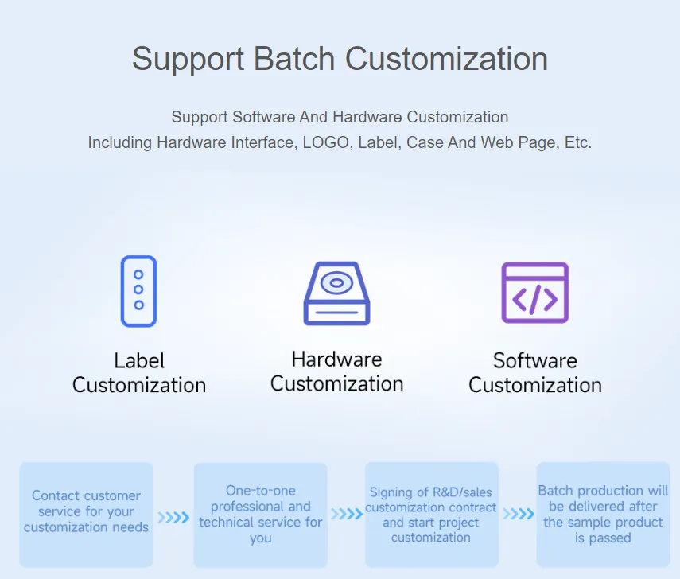

# FAQ

Q: How to get more library support for the demo?

A: You can subscribe to this repository and raise an issue to describe your requirements. The engineers will assess your request as soon as possible: [ESP32-display-support](https://github.com/waveshareteam/ESP32-display-support/tree/master)

Q: Why does the flashing fail?

1.  When the serial port is occupied, the flashing will fail. Close the serial port monitor and try to flash again
2.  When the ESP32 program crashes, the flashing will fail. In this case, you need to completely power off the development module, hold down BOOT button and power it on again to enter the forced download mode and then flash it. It will not automatically exit the download mode after flashing, so you need to power off and restart again

Q: How can I check which COM port I am using?

**Windows System**:

1.  Through Device Manager: Press the Windows + R keys to open the "Run" dialog box; input devmgmt.msc and press Enter to open the Device Manager; expand the "Ports (COM and LPT)" section, where all COM ports and their current statuses will be listed.
2.  Using Command Prompt: Open the Command Prompt (CMD), enter the mode command, which will display status information for all COM ports.
3.  Check the hardware connection: If you have already connected an external device to the COM port, the device usually occupies a port number, which can be determined by checking the connected hardware.

**Linux System**:

1.  Use the `dmesg` command: Open the terminal.
2.  Use the `ls` command: Enter `ls /dev/ttyS*` or `ls /dev/ttyUSB*` to list all serial port devices.
3.  Use the `setserial` command: Enter `setserial -g /dev/ttyS*` to view the configuration information of all serial port devices.

Q: Can you help me review or modify my code? Can you help me modify the code?

A: This product is positioned as a development board, not a finished product. The ecosystem is based on the mature ESP32 core, featuring a friendly development environment. We do not assist in modifying the code. And we encourage makers and enthusiasts to explore their DIY capabilities. If you have any questions, please feel free to ask our engineers for answers.

If you find our product satisfactory and are interested in batch hardware customization, custom enclosures, or custom software, please contact our [sales department](https://www.waveshare.com/contact_us).

Q: How to use SquareLine Studio to design interfaces?

A: Please refer to **[SquareLine Studio Tutorial](https://www.waveshare.com/wiki/Waveshare_SquareLine_Studio)**.

[Give Feedback](https://docs.google.com/forms/d/e/1FAIpQLSfayJEZ5J-dp-3Wq_dkWsVRhNuQ6C79_GNV62mYuFW8Mj6U8Q/viewform)
