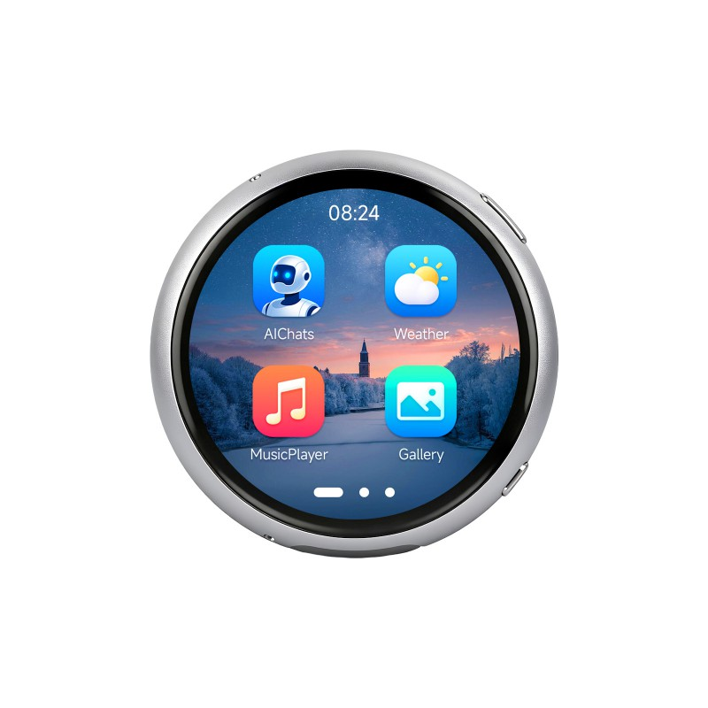
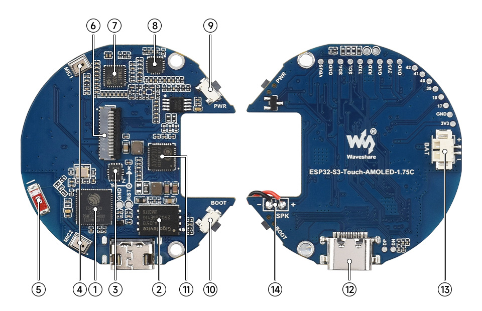
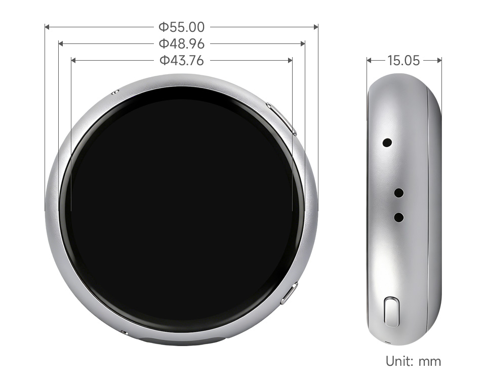

# ESP32-S3-Touch-AMOLED-1.75C

The ESP32-S3-Touch-AMOLED-1.75C is a microcontroller development board from Waveshare with a compact, badge-style CNC-machined aluminum alloy enclosure. It integrates a 1.75-inch capacitive AMOLED touchscreen, a power management IC, a six-axis sensor (accelerometer and gyroscope), an RTC, a low-power audio codec, echo cancellation circuitry, and a built-in speaker. The enclosure has space for a battery.

**If you are looking for:**

- **Coding with AI tools**: Click **Ask AI** and select an AI tool to ask questions about this page, or choose **Copy page** to copy its content and paste it into an AI tool for coding assistance.
- **Schematics, datasheets, and example code**: See [Resources](https://docs.waveshare.com/ESP32-S3-Touch-AMOLED-1.75C/Resources-And-Documents)
- **Arduino development**: See [Working with Arduino](https://docs.waveshare.com/ESP32-S3-Touch-AMOLED-1.75C/Arduino)
- **ESP-IDF development**: See [Working with ESP-IDF](https://docs.waveshare.com/ESP32-S3-Touch-AMOLED-1.75C/ESP-IDF)
- **Troubleshooting**: See [Product FAQ](https://docs.waveshare.com/ESP32-S3-Touch-AMOLED-1.75C/FAQ) or contact [Technical Support](https://docs.waveshare.com/ESP32-S3-Touch-AMOLED-1.75C/Technical-Support)

| SKU   | Product                                            |
|-------|----------------------------------------------------|
| 33691 | ESP32-S3-Touch-AMOLED-1.75C (Battery Included)     |
| 33692 | ESP32-S3-Touch-AMOLED-1.75C (Battery Not Included) |

## Back Cover Removal and Battery Installation Tutorial

[Video: back cover removal and battery install](images/Esp32-S3-Touch-Amoled-1.75C-EN-884542de9d9df2257b61f00d6b2c9f15.mp4)

## Features

- Equipped with ESP32-S3R8 high-performance Xtensa 32-bit LX7 dual-core processor, with a clock frequency up to 240MHz
- Supports 2.4GHz Wi-Fi (802.11 b/g/n) and Bluetooth 5 (LE), with onboard antenna
- Built-in 512KB SRAM and 384KB ROM, with stacked 8MB PSRAM and external 32MB Flash
- Utilizes a Type-C interface, improving user convenience and device compatibility
- Onboard 1.75inch capacitive touch HD AMOLED screen, 466 × 466 resolution, 16.7 million colors, capable of clearly displaying color images
- Uses an AMOLED screen, offering higher contrast, wider viewing angles, richer colors, and faster response times for superior visual effects, along with advantages like thin design, low power consumption, and flexibility
- Built-in CO5300 driver chip and CST9217 capacitive touch controller chip, communicating via QSPI and I2C interfaces respectively, minimizing the use of I/O pin resources
- Equipped with a dual-microphone array for audio algorithms such as noise reduction and echo cancellation, suitable for accurate speech recognition and near-field/far-field wake-up applications
- Onboard QMI8658 6-axis IMU (3-axis accelerometer and 3-axis gyroscope) for detecting motion and orientation, counting steps, and other applications
- Two side buttons, PWR and BOOT, with programmable functions
- MX1.25 connector for a 3.7 V lithium battery, supporting charging and discharging
- Adopts AXP2101 IC for efficient power management, supporting multiple voltage outputs, integrating charging and battery management functions, while optimizing battery lifespan

## Onboard Resources

1.  **ESP32-S3R8** Wi-Fi and Bluetooth SoC, 240MHz operating frequency, with stacked 8MB PSRAM
2.  **32MB NOR Flash**
3.  **QMI8658** Six-axis Inertial Measurement Unit (IMU), containing a 3-axis gyroscope and a 3-axis accelerometer
4.  **Dual-microphone Design** Combined with echo cancellation circuitry for higher quality audio capture
5.  **Onboard Antenna** Supporting 2.4GHz Wi-Fi (802.11 b/g/n) and Bluetooth 5 (LE)
6.  **Screen Interface**
7.  **ES7210 Audio ADC** Captures microphone audio for processing
8.  **ES8311 Audio Codec Chip**
9.  **PWR Power Button** Controls power on/off and supports custom functions
10. **BOOT Button** Used for device startup and functional debugging
11. **AXP2101** Highly integrated power management IC
12. **Type-C Interface** ESP32-S3 USB interface for firmware flashing and serial logging
13. **MX1.25 Lithium Battery Interface** MX1.25 2PIN connector for connecting a 3.7V lithium battery, supports charging and discharging
14. **Onboard Speaker Pads**

## Dimensions

## Development Methods

The ESP32-S3-Touch-AMOLED-1.75C supports two development frameworks: Arduino IDE and ESP-IDF, providing developers with flexible choices. You can select the appropriate development tool based on project requirements and personal preference.

Arduino generally offers a gentler learning curve and may be more approachable for beginners and hobbyists. ESP-IDF provides advanced tooling and finer control over system behavior, making it better suited to complex projects and applications with demanding performance requirements.

- **Arduino IDE** is a convenient, flexible, and easy-to-use open-source electronics prototyping platform. It requires minimal foundational knowledge, allowing for rapid development after a short learning period. Arduino has a vast global community that provides a wealth of open-source code, project examples, tutorials, and rich libraries that encapsulate complex functionalities, enabling developers to implement various features quickly. You can refer to the **[Working with Arduino](https://docs.waveshare.com/ESP32-S3-Touch-AMOLED-1.75C/Arduino)** to complete the initial setup, and the tutorial also provides related demos for reference.

- **ESP-IDF** (Espressif IoT Development Framework) is a professional development framework released by Espressif for its ESP series chips. It is developed based on the C language, including a compiler, debugger, and flashing tool, etc. It supports development via command line or an Integrated Development Environment (such as Visual Studio Code with the Espressif IDF plugin), which provides features like code navigation, project management, and debugging, etc. We recommend using VS Code for development. For the specific configuration process, please refer to the **[Working with ESP-IDF](https://docs.waveshare.com/ESP32-S3-Touch-AMOLED-1.75C/ESP-IDF)**. The tutorial also provides relevant demos for reference.

[Give Feedback](https://docs.google.com/forms/d/e/1FAIpQLSfayJEZ5J-dp-3Wq_dkWsVRhNuQ6C79_GNV62mYuFW8Mj6U8Q/viewform)
