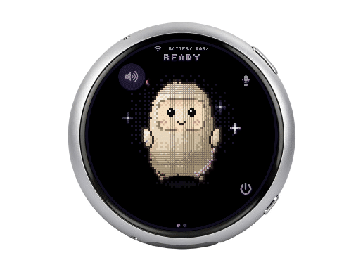
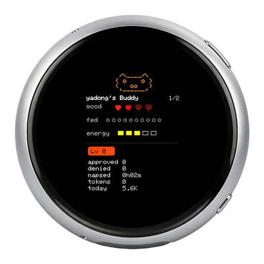
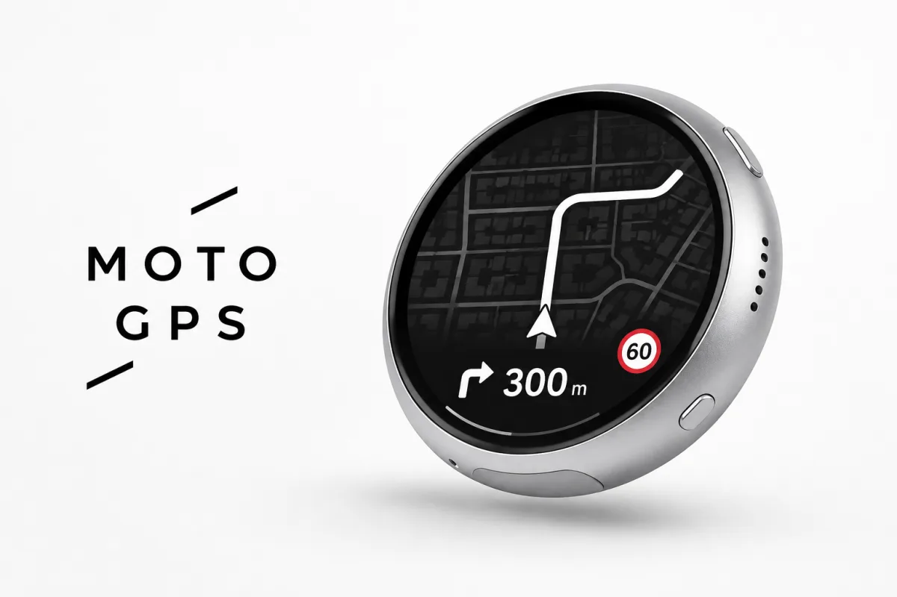
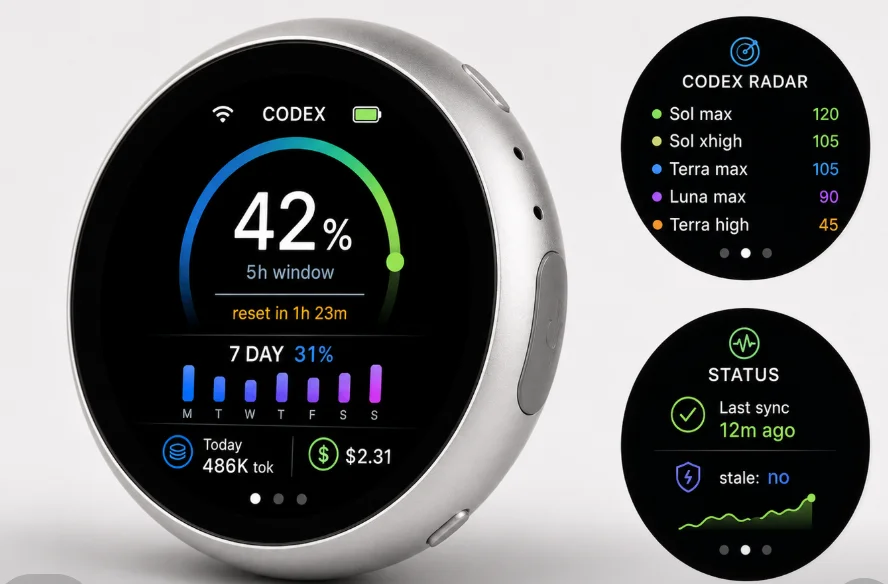

# Resources

## 1. Examples

- [ESP32-S3-Touch-AMOLED-1.75C Examples (GitHub)](https://github.com/waveshareteam/ESP32-S3-Touch-AMOLED-1.75C)
- [ESP32-S3-Touch-AMOLED-1.75C Source Archive](https://github.com/waveshareteam/ESP32-S3-Touch-AMOLED-1.75C/archive/refs/heads/main.zip)
- [ESP32-S3-Touch-AMOLED-1.75C Firmware Releases](https://github.com/waveshareteam/ESP32-S3-Touch-AMOLED-1.75C/releases)

## 2. Hardware Resources

- [ESP32-S3-Touch-AMOLED-1.75C Schematic Diagram](https://github.com/waveshareteam/ESP32-S3-Touch-AMOLED-1.75C/raw/main/hardware/schematic/ESP32-S3-Touch-AMOLED-1.75C-schematic.pdf)

## 3. Technical Manuals

- **ESP32-S3 Chip Official Manuals**

  - [Datasheet](https://documentation.espressif.com/esp32-s3_datasheet_en.pdf)
  - [Technical Reference Manual](https://documentation.espressif.com/esp32-s3_technical_reference_manual_en.pdf)

- **Datasheets**

  - [QMI8658 Datasheet](https://files.waveshare.com/wiki/common/QMI8658C.pdf)
  - [AXP2101 Datasheet](https://files.waveshare.com/wiki/common/X-power-AXP2101_SWcharge_V1.0.pdf)
  - [ES8311 Datasheet](https://files.waveshare.com/wiki/common/ES8311.DS.pdf)
  - [ES8311 User Manual](https://files.waveshare.com/wiki/common/ES8311.user.Guide.pdf)

## 4. Community Showcase

info

Check out these amazing projects created by the community! Please note these are independently maintained by their creators.

### Muse Gadgets

Image source: [Muse Gadgets](https://gadgets.muse.ai/).

Muse Gadgets is an open-source project that connects development boards to Muse through device SDKs and firmware. On the ESP32-S3-Touch-AMOLED-1.75C, it supports an on-screen avatar, images from Muse, touch controls, and push-to-talk voice interaction using the onboard microphones and speaker. Pairing requires the Muse mobile app and an SDK token.

- Website: [Muse Gadgets Project Website](https://gadgets.muse.ai/)
- GitHub: [Muse Gadget SDK ESP32 Device Guide](https://github.com/facebookincubator/muse-gadget-sdk/blob/main/esp32/devices/README.md)

### Yadong - Claude Desktop Buddy (ESP32-S3-Touch-AMOLED-1.75C port)")

- GitHub: [https://github.com/vthinkxie/claude-desktop-buddy-esp32](https://github.com/vthinkxie/claude-desktop-buddy-esp32)

### Maler X - MOTO GPS · Waveshare Edition

Image source: [MOTO GPS · Waveshare Edition](https://github.com/mx3353672833-debug/moto-gps-waveshare), © 2026 Maler X, licensed under [PolyForm Noncommercial 1.0.0](https://polyformproject.org/licenses/noncommercial/1.0.0). The image is a product appearance render.

- Guide: [https://maler.top/](https://maler.top/)
- GitHub: [https://github.com/mx3353672833-debug/moto-gps-waveshare](https://github.com/mx3353672833-debug/moto-gps-waveshare)

### Volos Projects - This ESP32 Looks Like a Pocket Watch… and It’s Beautiful \| Waveshare ESP32-S3 1.75"

# An error occurred.

Unable to execute JavaScript.

- YouTube: [https://www.youtube.com/watch?v=W-lYTZbaP4I](https://www.youtube.com/watch?v=W-lYTZbaP4I)
- GitHub: [https://github.com/VolosR/WaveStopwatch](https://github.com/VolosR/WaveStopwatch)

### Codex Island for Waveshare 1.75C

Image source: [Codex Island for Waveshare 1.75C](https://github.com/WildBeast114514/codex-island-waveshare). The image is a UI design reference.

- GitHub: [https://github.com/WildBeast114514/codex-island-waveshare](https://github.com/WildBeast114514/codex-island-waveshare)

### vadmalis - ESP32-S3 Aerospace tracker

- Reddit: [https://www.reddit.com/r/esp32/comments/1vd9yj2/esp32s3_aerospace_tracker/](https://www.reddit.com/r/esp32/comments/1vd9yj2/esp32s3_aerospace_tracker/)
- Guide: [https://www.dropbox.com/scl/fi/np4ofr8mcjijmvzktqjy8/Aerospace_Tracker_Interaction_Guide_No_Footer.pdf?rlkey=izsuxj7gyafratjulqe132xwg&e=1&dl=0](https://www.dropbox.com/scl/fi/np4ofr8mcjijmvzktqjy8/Aerospace_Tracker_Interaction_Guide_No_Footer.pdf?rlkey=izsuxj7gyafratjulqe132xwg&e=1&dl=0)

### Nurdism - Falling sand sim on a round AMOLED, ESP32-S3

# An error occurred.

Unable to execute JavaScript.

- YouTube: [https://www.youtube.com/watch?v=Gdmk3TZFWq0](https://www.youtube.com/watch?v=Gdmk3TZFWq0)
- GitHub: [https://github.com/nurdism/esp_sand_sim](https://github.com/nurdism/esp_sand_sim)

### Valleytech Custom Solutions - WAVESHARE'S 1.75IN ROUND AMOLED DEVELOPMENT BOARD

# An error occurred.

Unable to execute JavaScript.

- YouTube: [https://www.youtube.com/watch?v=T7CcLiFXEsY](https://www.youtube.com/watch?v=T7CcLiFXEsY)

### Volos Projects - I Built an ESP32 Internet Radio WITHOUT Code or AI! \| LCD Wizard TUTORIAL

# An error occurred.

Unable to execute JavaScript.

- YouTube: [https://www.youtube.com/watch?v=jtauKTxIVHA](https://www.youtube.com/watch?v=jtauKTxIVHA)
- Guide: [https://lcdwizard.com/](https://lcdwizard.com/)

[Give Feedback](https://docs.google.com/forms/d/e/1FAIpQLSfayJEZ5J-dp-3Wq_dkWsVRhNuQ6C79_GNV62mYuFW8Mj6U8Q/viewform)
